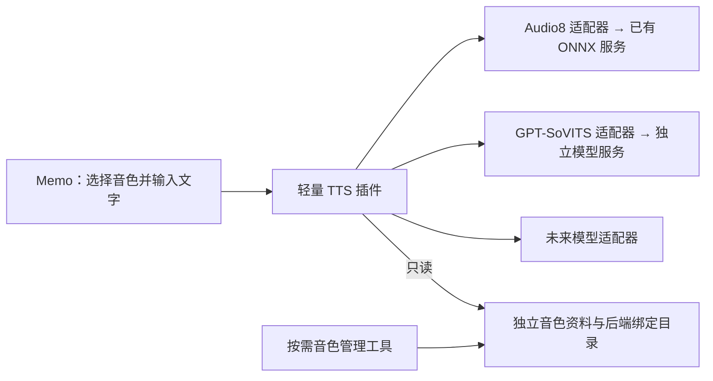

# Memo 多模型本地 TTS 插件设计稿

版本：v2.1；状态：已确认设计基线，进入实现。2026-10-14 补充 Audio8 同进程身份接口，以本文件当前版本为准，替代上一版“插件 → 常驻统一代理 → 模型服务”的方案。不代表功能已实现。

执行授权：主人于 2026-10-13 确认按本稿制定执行方案，由 DeepSeek V4.1 Flash 编写代码，GLM 5.3 Flash 独立 review 与校验，Friday 主控。实现及验收状态另见执行方案和任务记录。

## 本次修订结论

推荐“一个 Memo 插件 + 内部后端适配器 + 按需使用的音色管理工具”。合成和音色查询直接调用现有模型服务，第一版不增加常驻统一 HTTP 代理。音色管理工具负责文件写入；插件在通过宿主模块加载验证后只读加载独立音色目录。

调整依据是本轮对 Memo 1.8.8 实际发布代码、官方 Edge 插件和已安装 Audio8 服务的核对：宿主已经提供动态选项接口，已有模型服务足以承接语音合成。原稿增加的常驻统一代理没有必要放在默认调用链中。

## 目标与已确认事实

主人要求一个可更换模型的 Memo 插件：首个后端使用 Audio8，保留 GPT-SoVITS 接入能力，以后可以增加更合适的模型。对不同讲师，继续支持临时音色和可保存、复用的音色。

本轮检查确认：

- Memo 安装版本为 1.8.8，实际“文本转语音”服务列表已经允许选择现有 GPT-SoVITS provider。
- 已安装插件仍是 1.0.0 静音占位版；直接调用只返回 100ms 静音 WAV。
- Audio8 已安装于本机，源码提交为 `07e40f5d0b03fc473635ef378654bfb581027ac3`；模型目录约 968MB，虚拟环境约 364MB。
- 已安装 Audio8 的 ONNX 推理代码使用 `CPUExecutionProvider`，模型、虚拟环境和已注册音色目录均存在；当前 8024 端口没有服务监听。
- 2026-09-01 历史验证记录包含真实 Audio8 HTTP 合成和合格 WAV；本轮没有启动服务或重新生成语音，历史性能不能作为当前验收。

## 方案选择

一个稳定的 Memo 插件入口，内部静态注册 Audio8、GPT-SoVITS 等适配器；模型计算继续在各自独立的本地服务运行。按需启动的音色管理工具负责参考音频、原文、后端绑定和临时资料，不成为日常合成的必经服务。

三种方案比较：

| 方案 | 优点 | 代价 | 判断 |
| --- | --- | --- | --- |
| 插件内部适配器，直接调用模型服务 | 少一个常驻进程和端口，复用 Memo 动态选项接口 | 新增模型要编写并发布适配器 | 推荐 |
| 常驻统一代理服务 | 可单独升级后端，还能服务多个应用 | 每次合成都依赖额外服务，增加启动、版本和超时排查 | 多应用共享或集中调度有明确需求时再评估 |
| 每个模型一个独立 Memo 插件 | 各插件容易单独开发 | 重复音色、配置和升级流程 | 不采用 |

插件自身不加载模型或 Python 环境，也不负责训练。新增模型是扩展一个经过测试的适配器；第一版不加载任意路径的第三方代码，不建设插件市场。

## Memo 入口与兼容

已核对的真实接口：

- 入口是 `module.exports = { default: TTS, getEditorOptions }`；`default` 提供 `async textToSpeech(options)`，成功返回音频 Buffer，失败返回可理解的错误字符串。
- 宿主会把 manifest 默认配置、用户保存配置与当前调用配置合并传入合成方法，并创建新的 TTS 实例。不能只在构造函数里保存可变后端选择。
- `getEditorOptions(request)` 是独立的模块导出函数，宿主通过 IPC 调用它获取动态选项；请求包含 `fieldKey`、`role`、`scope`、`config` 和 `query`。
- 宿主将返回选项规范化为 `{ value, label }`，其他附加字段不会保留。因此 backendId、endpointId 和后端音色绑定 ID 必须包含在可解析、带版本的 `value` 中，不能依赖额外元数据。
- 宿主选项异常会被转换为空列表，旧配置还可能成为回退选项。插件必须在合成前重新核验服务和音色，不能仅靠列表校验。

加载方式采用官方已安装 Edge 插件的 `importType: "module"`。这是 Memo 的宿主模块加载分支，实际执行 Node `require()`，发布入口仍是单文件 CommonJS 导出；不是把入口改成未经验证的原生 ESM。

该分支允许读取文件和 HTTP 请求，因此插件可以只读加载自身独立的音色目录。原 CommonJS 沙箱只允许限定内置模块，不含 `fs`，也不支持相对运行时依赖；两种加载方式不能混为一谈。升级加载方式必须先在真实宿主中验证，打包脚本与契约测试应同步更新，不能继续沿用旧的 commonjs 固定断言。

首轮保留现有 pluginId 和 provider.value，避免更换身份丢失已有引用；说明文案改为多后端用途。显示标题可以在通过原生升级验证后调整为“本地语音合成”。本轮还查明：1.8.8 的白名单过滤只作用于在线目录里的已知插件 ID，未列入目录的自定义 ID 可以展示；不再把标题包含 GPT-SoVITS 当成展示条件。

Memo 使用 `model` 字段表示后端，标签为“语音引擎”；`voiceName` 表示该引擎下的音色，通过动态选项加载。不能把“模型版本”和“后端类型”永久混成一个名称，后端描述另外记录模型版本/指纹。

若服务地址等隐藏配置未包含在 `getEditorOptions(request).config` 中，使用独立目录中的已校验 endpoint 配置补足，并在实现前验证实际传参。不能靠编造新的 Memo 回调解决此缺口。

## 统一接口与适配器

统一的是插件内部接口，而不是再提供一套 HTTP 服务：

- `probe(context)`：检测配置是否完整、服务是否可达、模型是否已加载；状态分别表示，不能把端口可连通当成合成已验证。
- `listVoices(context)`：返回该后端的音色绑定，区分已注册、需要准备、失效和不可连接。
- `synthesize(request)`：接收固定的后端/端点、音色绑定、文字和被支持的参数；返回音频及格式信息。

音色创建/注册属于管理工具的 `prepareVoice` 流程，不在普通合成过程中隐式执行。每个适配器用明确的能力描述记录原生速度、情感、流式、语言、参考原文等；不把所有模型强迫映射成 OpenAI 同一种请求。

能力决定具体参数映射与验证，但不能假设 Memo 可按后端动态隐藏 manifest 中的字段。Audio8 第一版不暴露语速滑块；以后要兼容更多模型，可用动态选择项表达有效值，或在独立管理界面配置高级能力，再验证宿主展示效果。

每次合成开始时固定配置快照。过程中改变全局引擎不能改变正在执行的请求；保存的脚本沿用其明确绑定的引擎。backend 与音色值的绑定不一致时要求重新选择，不能把旧音色名称传给新后端。

第一版仅消费完整 WAV，不加入跨模型自动回退、整课任务平台或复杂队列框架。HTTP 客户端默认仅接受已配置的 loopback 地址，限制响应大小和超时，不采用 Memo 为云服务注入的代理 agent，不自动跟随到未知地址的重定向。

## Audio8 首个后端

复用已安装的 `onnx_runtime`，不重新安装或升级，不修改其已有音色和原始材料。

已核对当前接口：

- `GET /api/health` 返回加载状态和 ONNX 执行 provider。
- `GET /api/voices` 返回已注册音色。
- `POST /api/voices/register` 接收参考音频、准确原文、名称和 overwrite 标志。
- `POST /api/tts` 接收 text、voice_name、采样参数，返回 WAV。
- `/v1/audio/speech` 也可返回 WAV；首轮优先使用已核对的 `/api/tts`。

Audio8 官方建议单段输入不超过约 150 字符；这是经验建议，不是其上下文长度的保证。实际参考音频 codes、参考原文和目标文本共用上下文；长参考音频会减少生成余量。首先限制每段长度并在真实测试中验证结尾完整，不能认为“成功得到 WAV”就一定读完全文。

当前原生接口没有 speed/rate、情感或显式目标 language 字段。语言主要由文本和模型能力决定；跨语言合成不能用参考音频的语言筛掉可用音色。Audio8 接口也不返回 EOS 与 token 上限停止原因，因此截断检测是剩余验证缺口；若无法可靠判断，应收紧分段策略，或为该模型增加经过验证的结果元数据封装，不能伪造完成状态。

语速后处理不纳入首个可用版本。旧版 0–100 slider 的 speed 值必须经过明确迁移，不能被误解释成 GPT-SoVITS 的 speed_factor，也不能悄悄发送给 Audio8。

服务启动由本机控制入口显式执行。先复用已有安装及音色，不在第一次合成时安装依赖、下载模型或设置自启动。当前服务自身有 request_lock，注册和合成串行；复用这道锁，不在新代理里再造一套调度。

## GPT-SoVITS 与新增模型

GPT-SoVITS 保留为单独适配器：复核实际 `/tts` 契约、参考音频/原文、语言、speed_factor 与模型状态后再接通。没有通过真实合成验收的后端标为不可用，不能因为注册了模块就宣称支持。

每个 GPT-SoVITS endpoint 明确绑定已经加载的模型组。第一版不在每句合成前调用全局权重切换接口；多客户端共享同一服务时这样做会出现讲师模型错用。需要多个训练模型时先采用独立、明确的 endpoint，或在后续专属服务封装中串行管理权重切换。

未来新增模型的常规工作是增加适配器、能力声明和测试，再发布新的 `.memox`。接口完全一致的新 endpoint 可只改配置；不同协议、不同模型权重或声音编码的模型不能承诺“只换名称即可使用”。若新模型没有稳定 HTTP API，再增加其专属服务封装。

切换后端失败时不自动使用另一个模型或声音，避免输出与主人所选讲师不一致。

## 音色资料与生命周期

音色资料分三层：

1. 原始资料：稳定 voiceProfileId、名称、参考音频、准确原文、参考语言和来源。
2. 后端绑定：backendId、endpointId、模型指纹、后端原生音色 ID、准备状态和 bindingRevision。
3. 派生缓存：Audio8 codec codes、其他模型的 embeddings/参数引用等，按模型与编码器指纹隔离。

保存讲师音色后，换模型可以用原始资料重新准备，不能直接复制旧模型缓存。已有 Audio8 profiles 可作为外部音色引用；其中 meta.json 只有原始文件名和 hash，不一定留有可用的原始音频。缺少原始录音或准确原文时必须提示补充，不能声称所有旧音色均能迁移。

管理工具不修改 Memo 的索引或应用资产。它只在独立目录写入原始资料和绑定记录；先完成后端准备，再以原子更新发布可用绑定，失败时保留原记录。已经登记的音色与既有输出默认只读引用，不自动认领为本项目可删除资料。

Audio8 当前 voices.load 不会检查 meta.json 的 model_fingerprint，虽然注册器会校验 encoder 与在线模型的匹配。适配器必须补上已有音色与当前模型指纹的验证；不能用文件存在代替可复用判断。远端 health 当前不暴露模型指纹，首轮通过已核对的本机安装 manifest 与 endpoint 配置关联；服务配置改变时要求重新核对，不从旧文件盲猜服务器模型。

2026-10-14 实施澄清：Audio8 使用本项目的轻量启动辅助入口，导入既有 FastAPI app，在同一模型服务进程增加只读 GET /api/memo/runtime。它从实际已加载的 runtime 对象返回 backendId、modelFingerprint、modelDir、voicesRoot、precision、codecPrecision 和随机服务实例 ID；不会另起代理、修改已安装源码、安装依赖或下载模型。插件将在线模型、真实路径与本机 manifest、音色元数据同时核对，每次合成前重新探测；普通裸服务缺少该接口时明确标为“未验证”，不根据人为填写 ready 绕过。首次实际合成仍是独立验收门槛，身份检查不能代替试音。已有声音可以只读使用原目录；创建新声音时使用明确归属的 voices root。

Audio8 绑定还保存原生音色元数据摘要 nativeVoiceFingerprint；同名音色在外部服务里被改写后不能无声地沿用旧绑定。插件校验新合成，管理工具重新确认并增加 revision；历史 Memo 脚本及已缓存音频不由管理工具自动改写或删除，宿主缓存行为须单独验证和说明。

### 临时与持久音色

- 临时音色也须保存足够的参考资料与后端绑定，使用随机 ID 和明确归属，不以讲师名称判断可删除性。
- 默认不纳入持久音色库；主人可以选择“保存音色”保留并命名。
- Memo 目前没有已核对的脚本结束/引用统计回调，options.uuid 也可能只是文本 hash。因此不能在一次 textToSpeech 返回后或窗口关闭时自动删除音色。
- “结束临时音色”由管理工具明确执行，展示将失效的绑定。既有 Memo 脚本若仍引用该临时音色，不能承诺日后能重新合成；需要持久保存时应先转为持久音色。
- 本机文件清理只能在模型服务已停止、无本项目操作进行时执行，且只处理带所有权记录的目录。未知完成状态的合成请求继续保护临时资料，不因超时开始删除。
- Audio8 没有删除 HTTP 接口；不编造 DELETE 调用，也不因仅监听 loopback 就绕过文件边界。若服务由主人独立启动，管理工具不得擅自停止它来清理文件。

恢复时只列出本项目遗留临时资料供处理，不自动批量删除。现有用户音色、参考材料与输出始终在清理范围外。

### 缓存和旧配置

同名讲师更换参考音频后可能仍命中 Memo 的旧合成缓存。原稿未处理这一点；新版要求音色绑定值包含 bindingRevision，合成相关参数必须进入 Memo 的 ttsInput/缓存计算路径，并实际验证更换录音、模型或 endpoint 后不会播放旧声音。若宿主缓存不包含某项参数，必须在实施中修正身份编码，不能宣称缓存可用。

保留 pluginId 不代表版本配置自动迁移。Memo 按 pluginId@version 保存配置；原生升级测试必须验证 endpoint 和默认模型是否保留，给出明确迁移路径。不能直接写真实 plugins/index.json 或用安装脚本覆盖插件目录。

## 错误与资源控制

- 分别报告服务未启动、模型未加载、音色不存在、参数不支持、请求超时和音频无效。
- 合成超时不能自动重发未知完成状态的请求；取消本地 HTTP 请求不代表模型已停止。第一版不承诺跨模型精确取消。
- 2026-10-14 已核对 Memo 的简单合成入口：它可能根据错误字符串里的英文超时、断连或限流字样自动再次调用。插件向宿主只返回固定中文分类错误，不回显这些原始错误码、服务正文、地址或可变诊断内容，以免误触宿主重试；内部校验保留具体错误。这里不能只测 HTTP 客户端没有重试。
- 配置中的 URL、voice value 和本机目录均作为数据解析，不作为 shell 命令或模块路径执行。
- 检查 HTTP 状态、WAV 容器、PCM 格式、长度和非静音内容，不把 JSON 错误或 HTML 当作音频返回。输出采样率由实际音频声明，不固定写成 32kHz。
- 分段 WAV 必须逐段解析后重新组装，不能直接拼接整份 WAV 字节。同一请求的采样率、声道和位深不一致时明确失败；第一版不引入未经验证的自动转换。
- 任一分段失败时整个请求失败，不把部分音频伪装成完整结果。主人输入的所有文本都须分段覆盖，不能无提示截掉尾部。
- 后端服务控制只启动/停止本项目拥有的进程，不为切换模型擅自结束用户已运行的服务，也不启动所有模型来填充菜单。
- 合成状态按本次请求固定；不要依赖每次被重新创建的插件实例保存全局状态。模块级协调只能覆盖 Memo 当前主进程，不能代替模型服务的跨客户端锁。

## 实现与验收顺序

1. 在 Memo 1.8.8 验证官方模块加载方式、HTTP 内置模块、getEditorOptions、动态语音选项和 Buffer 消费。验证版本化配置与缓存计算；未验证前不发布升级包。
2. 启动已有 Audio8，使用既有测试音色生成短中文与中英混合语音，确认当前非静音 WAV、结尾完整、耗时及内存。先连接已有音色，避免边调接口边更改原始材料。
3. 实现插件内的适配器契约和 Audio8 直接 HTTP 调用，完成模型/音色绑定校验、超时、错误和分段 WAV 测试。
4. 增加动态 getEditorOptions、manifest、单文件构建和升级迁移，使用 Memo 原生导入完成第一条真实链路。
5. 增加按需音色管理工具与资料目录，验证临时/持久转换、相同姓名不同资料、指纹失效、缓存更新和清理边界。
6. 接通 GPT-SoVITS 适配器并独立验收；它尚未就绪时显示“未配置”，不能声称双后端可用。
7. 用第二个真实适配器验证扩展性；再用同一参考音频与文本比较两后端，资源和质量结论来自本机测量。

Audio8 验收通过条件：Memo 可以选择真实音色、输入文字后生成可播放且内容正确的音频；长句不漏末尾；服务不运行和音色缺失时有明确错误；现有 Memo 插件与用户音色不受影响。

## 实现前剩余验证

以下是已经定位的技术验证项，不是留给实现者自由猜测的设计：

- 官方模块加载分支、getEditorOptions 和配置合并已经由 1.8.8 源码确认；本项目新入口尚未在真实宿主执行。
- getEditorOptions 的隐藏配置传递、后端切换后 UI 刷新、声音 bindingRevision 是否进入缓存，需要真实交互验证。
- Audio8 安装与当前接口已确认；本轮未启动服务、生成语音或测量内存，历史语音测试不能代替此次验收。
- Audio8 裸 WAV 接口不提供生成停止原因；需要真实长句和参考音频测试后确定分段上限，必要时再加入该后端专属结果封装。
- GPT-SoVITS 当前实例、模型组和合成能力仍未重新验证；它是计划中的第二适配器。
- 本稿的直接调用方案只承诺 Memo 单应用、本机已有 HTTP 服务。日后明确需要多应用集中音色与调度时，再讨论统一常驻代理。

## 复核证据

本轮从 Memo app.asar 提取到临时目录只读分析，未修改应用或已安装插件：

- main `_loadLocalPlugin`：importType 为 module 时用 Node require；CommonJS 沙箱内置列表含 http/https，不含 fs。
- main `getPluginProvidedOptions`：调用模块导出的 getEditorOptions 并规范化 value/label。
- main `createPluginInstance` / `callPluginTextToSpeech`：每次创建实例，合并默认、保存与当前调用配置。
- main `isProviderVisible`：白名单仅限制在线插件目录里的已知 ID。
- 当前 Edge 1.1.0 入口实际导出 default 和 getEditorOptions，manifest 使用 module。
- Audio8 `service.py`：注册与合成共用 request_lock；TtsRequest 不含 speed/language 字段；HTTP WAV 无停止原因。
- Audio8 `registration.py` / `voices.py`：注册写入参考音频名称/hash 与 model_fingerprint，但读取声音时不校验该指纹。

## 官方依据

- Audio8 项目：https://github.com/Audio8-AI/Audio8_TTS
- CPU ONNX 接口与资源说明：https://github.com/Audio8-AI/Audio8_TTS/blob/master/onnx_runtime/README.md
- Apache-2.0 许可证：https://github.com/Audio8-AI/Audio8_TTS/blob/master/LICENSE

官方的约 1.1–1.2GiB 合成峰值来自 Apple M2、5 线程测试，不能当成本机 M1 Max 当前测量。此次没有生成新语音或更改真实模型服务；性能与质量需要在实现前重新验证。
